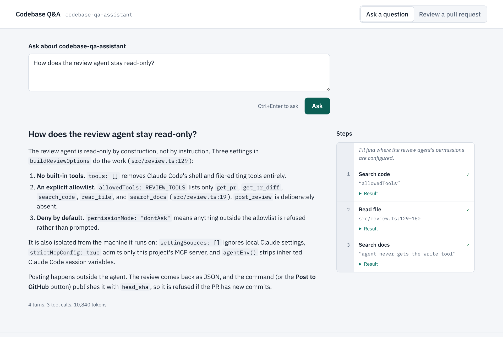
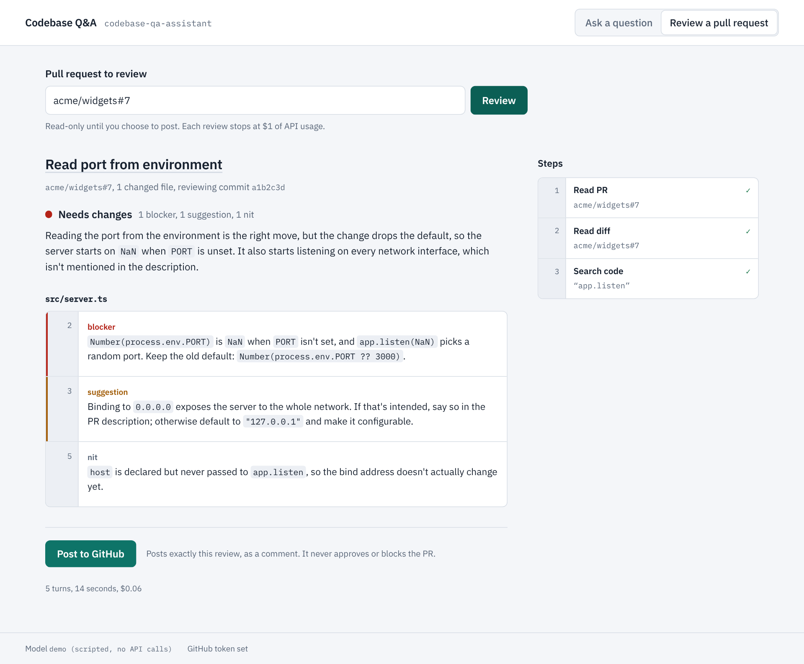

# Codebase Q&A and PR Review Assistant

An agentic assistant built on the Claude API that answers questions about a codebase and reviews GitHub pull requests, grounded in the actual code and docs. Its tools are served by a custom **MCP server** over Streamable HTTP, so the same tools work for this app, Claude Code, and any other MCP client.

**Stack:** TypeScript / Node, Claude API (`@anthropic-ai/sdk`), Claude Agent SDK (`@anthropic-ai/claude-agent-sdk`), Model Context Protocol (`@modelcontextprotocol/sdk`), GitHub REST API, Express, Angular 21 (signals, zoneless).



## Status

- **Phase 1 — complete.** Hand-written Messages API tool loop.
- **Phase 2 — complete.** Custom MCP server (Streamable HTTP) with code search, file reading, and documentation retrieval; the agent discovers its tools from the server at runtime.
- **Phase 3 — complete.** Pull-request review: GitHub PR tools on the MCP server, and a `review` command orchestrated by the Claude Agent SDK that returns a structured, line-anchored review and can publish it to GitHub.
- **Phase 4 — complete.** Angular web UI: streaming answers, a live trace of every tool call, and PR reviews you can read before posting the exact draft to GitHub.
- **Phase 5 — in progress.** Hosting on Azure. Every merge deploys from GitHub Actions to Azure Container Apps, with infrastructure as code (Bicep) and keyless OIDC sign-in:
  - a public, scripted demo;
  - the real assistant, private behind GitHub sign-in and an allowlist, with its keys in Key Vault.

### Tools

| Tool | What it does |
|---|---|
| `search_code` | Case-insensitive search across text files; returns `file:line` hits with context, capped at `k` |
| `read_file` | Reads a file with line numbers, 200 lines per call; refuses any path outside the repo root |
| `search_docs` | Retrieval over READMEs, design docs, and ADRs: heading-aware chunking + BM25 ranking, returns cited passages |
| `get_pr` | A GitHub PR's title, description, author, branches, head commit, and changed files with line counts |
| `get_pr_diff` | The PR diff with new-file line numbers in a gutter, paged at ~24k characters; one file at a time with `path`. Lockfiles and minified bundles are collapsed unless requested by `path` |
| `post_review` | Publishes a review as a single **COMMENT** (never approve or request changes). Off unless enabled; see below |

Every tool validates its inputs with zod schemas and returns compact output to keep context and token use down. All but `post_review` are marked read-only (`readOnlyHint`).

## Quick start (Windows / PowerShell)

```powershell
npm install
Copy-Item .env.example .env
# edit .env: set ANTHROPIC_API_KEY and REPO_PATH (the repo you want to ask about)
npm run ask -- "Where is the HTTP interceptor configured, and what does it add to requests?"
```

Without `MCP_SERVER_URL` set, tools run in-process (Phase 1 mode). Tool calls print to stderr as they happen (`↳ search_code {...}`), followed by the answer and a token summary.

### Using the MCP server

Terminal 1 — start the server:
```powershell
npm run serve
# MCP server "codebase-qa" listening at http://127.0.0.1:3333/mcp
```

Terminal 2 — set `MCP_SERVER_URL=http://127.0.0.1:3333/mcp` in `.env`, then ask as usual:
```powershell
npm run ask -- "Why does the server refuse to bind to 0.0.0.0 without a token?"
# Tools: mcp:http://127.0.0.1:3333/mcp
```

### Reviewing a pull request

```powershell
npm run review -- tpotechno/codebase-qa-assistant#1
# or a URL:  npm run review -- https://github.com/owner/repo/pull/123
```

The review agent reads the PR, pages through the whole diff, looks up surrounding code with the repo tools when it needs context, and prints a review:

```
## AI review: owner/repo#123

**Verdict:** Minor issues (1 blocker, 2 suggestions)

<summary>

### Comments
- **blocker** `src/server.ts:42` — PORT may be unset; Number(undefined) is NaN. Default to 3000.
...
[9 turn(s), $0.0812, 41.3s]
```

- **Draft by default.** Nothing is posted unless you add `--post`. `--out review.md` also saves it to a file.
- **Publishing:** `npm run review -- owner/repo#123 --post` posts the summary plus inline comments on the exact lines. Comments that land outside the diff are moved into the summary instead of failing the review.
- **One terminal.** If `MCP_SERVER_URL` isn't set, the command starts a private MCP server in-process on a random port with a one-time token.
- **Spend cap.** Each review stops at `REVIEW_MAX_BUDGET_USD` (default $1.00).

**GitHub token.** Public PRs work without one (GitHub allows 60 unauthenticated requests per hour). For private repos, higher limits, or `--post`, create a fine-grained token at github.com → Settings → Developer settings → Personal access tokens → Fine-grained tokens, limited to the repositories you want reviewed, with **Pull requests: Read and write** and **Contents: Read-only**. Put it in `.env` as `GITHUB_TOKEN=`.

## Web UI

```powershell
npm run web:install   # once: install the Angular app's packages
npm run web:build     # build the UI
npm run web           # http://localhost:3334
```

Uses the same `.env` as the command line. Two modes:

- **Ask a question.** The answer streams in as it's written. The Steps panel shows each tool call as it happens (what was searched, which lines were read) with the result one click away. Short notes Claude writes before calling a tool appear there too, so the answer itself stays clean.
- **Review a pull request.** Enter `owner/repo#123` or a PR link. You get the verdict, the summary, and comments grouped by file with their line numbers. **Post to GitHub** publishes exactly the draft on screen, as a comment: the server keeps each review it generates and posts it by id, at most once, and refuses if the PR has new commits since the review started.



**Try it without an API key:** `npm run web:demo` serves the UI on port 3335 with a scripted stand-in for Claude. The repo tools run for real against this repository; the review uses a sample PR (`acme/widgets#7`) from an in-memory GitHub, and nothing is sent anywhere.

**Hosted demo:** the same scripted demo runs on Azure Container Apps, deployed by `.github/workflows/deploy.yml`. The URL is on the repository's `azure-demo` environment. See [docs/azure_deployment.md](docs/azure_deployment.md) for how it's built and the one-time Azure setup. To run the container locally: `docker build -t codebase-qa-demo . && docker run -p 3335:3335 codebase-qa-demo`.

**Developing the UI:** run `npm run web` in one terminal and `npm run web:dev` in another, then open http://localhost:4200. `ng serve` reloads on save and proxies `/api` to the server.

**Security.** The server holds your Anthropic and GitHub credentials, so it listens on `127.0.0.1` only and rejects requests whose `Host` isn't its own (DNS rebinding), requests from other sites' pages (`Origin` check), and anything that isn't JSON (cross-site forms). Only reviews the server itself produced can be posted (by id, once each, for an hour), so nothing that reaches the API can publish arbitrary text under your GitHub account. Raw HTML in model output is shown as text. Closing the tab or pressing **Stop** cancels the run, so it stops spending. At most two runs can be active at once.

| Variable | Default | Purpose |
|---|---|---|
| `WEB_PORT` | `3334` | Port for `npm run web` |

### Using the MCP server from Claude Code

With the server running:
```powershell
claude mcp add --transport http codebase-qa http://127.0.0.1:3333/mcp
```
Claude Code can then call the repo tools and the PR tools, e.g. "use codebase-qa to summarize the risky parts of PR #12".

### Server configuration

| Variable | Default | Purpose |
|---|---|---|
| `REPO_PATH` | current folder | Repository the tools are confined to |
| `MCP_PORT` | `3333` | Port to listen on |
| `MCP_HOST` | `127.0.0.1` | Bind address; local-only by default, with DNS-rebinding protection |
| `MCP_AUTH_TOKEN` | — | If set, clients must send `Authorization: Bearer <token>`. **Required** for any non-local host |
| `GITHUB_TOKEN` | — | GitHub token for the PR tools (private repos, higher rate limits, posting) |
| `GITHUB_ALLOW_POST` | `false` | Set `true` to register `post_review` on a standalone server (also needs `GITHUB_TOKEN`). `npm run review --post` enables it on its embedded server automatically |
| `REVIEW_MAX_BUDGET_USD` | `1` | Spend cap per review |

`GET /health` returns server name and version without auth, for uptime checks.

### Troubleshooting

- **`401 invalid x-api-key`** — the key was rejected. Values in `.env` take priority over Windows environment variables, so check the `.env` line is exactly `ANTHROPIC_API_KEY=sk-ant-...` (no quotes or spaces), or create a new key in the Console.
- **`GitHub 404` / `GitHub 403`** on a PR — the PR is private or you hit the unauthenticated rate limit; set `GITHUB_TOKEN`.
- **`Review failed: spend cap ... reached`** — raise `REVIEW_MAX_BUDGET_USD` for very large PRs.
- **"Can't reach the local server" in the browser** — start it with `npm run web`. **"The web UI isn't built yet"** — run `npm run web:build`.
- **`Could not connect to MCP server`** — start it with `npm run serve` in another terminal, or remove `MCP_SERVER_URL` from `.env` to use local tools.
- **`npm.ps1 cannot be loaded ... not digitally signed`** — run `Set-ExecutionPolicy -Scope CurrentUser RemoteSigned`, or use `npm.cmd` instead of `npm`.
- **npm 12 `install-scripts` warning for esbuild** — run `npm install-scripts approve esbuild`, then `npm install`.

## Tests

```powershell
npm run typecheck
npm test          # API, agents, MCP server
npm run web:test  # Angular UI
```

The tests need no API key or network. The web API tests stream real Server-Sent Events from the server, using a fake Claude client that streams text and a fake GitHub, and check the cross-site protections. The Angular tests cover the event-stream parser, the trace, and the review helpers. The rest cover the tools directly, document chunking and ranking, the MCP server over real HTTP (tool discovery, schema validation, path-traversal refusal, bearer-token auth), the GitHub client against an in-memory fake GitHub API (paging, error hints, diff line mapping, folding out-of-diff comments), the review agent against a scripted Agent SDK message stream (read-only tool allowlist, spend cap, error handling), and the full agent loop running against the server with a scripted fake Claude client.

## Architecture

```
┌──────────────────────────────────────────────┐
│  Angular UI (web/) ── SSE over fetch ──┐      │  Phase 4
│  Web API (src/web-app.ts) ◀────────────┘      │
├──────────────────────────────────────────────┤
│  ask:    src/agent.ts — hand-written loop     │  Phase 1–2
│            └─ ToolProvider: local | MCP       │
│  review: src/review.ts — Claude Agent SDK     │  Phase 3
├──────────────────────────────────────────────┤
│  MCP server (src/mcp-server.ts)               │  Phase 2–3
│    Streamable HTTP · stateless · bearer auth  │
├──────────────────────────────────────────────┤
│  Data: repo files · doc index (BM25) · GitHub │  Phase 2–3
└──────────────────────────────────────────────┘
```

Design docs:
- **Phase 2, MCP server:** [docs/mcp_server_design.md](docs/mcp_server_design.md) ([PDF](docs/mcp_server_design.pdf))
- **Phase 3, PR review:** [docs/pr_review_design.md](docs/pr_review_design.md) ([PDF](docs/pr_review_design.pdf))
- **Phase 4, web UI:** [docs/web_ui_design.md](docs/web_ui_design.md) ([PDF](docs/web_ui_design.pdf))
- **Phase 5, Azure deployment:** [docs/azure_deployment.md](docs/azure_deployment.md)

The Phase 3 and 4 PDFs are generated from their Markdown, e.g. `python scripts/md_to_pdf.py docs/web_ui_design.md docs/web_ui_design.pdf` (requires `pip install reportlab`).

**Design notes**

- **Client-side MCP.** The agent connects to the server with the MCP client SDK, lists its tools, and translates them into Messages API tool definitions. This works against a server on `localhost`. (The Messages API's built-in MCP connector needs a publicly reachable server, which fits the hosted deployment in Phase 5.)
- **Pluggable tool source.** The agent loop depends only on a `ToolProvider` interface, so in-process tools and MCP tools are interchangeable — and new server tools reach the agent with no agent code change.
- **Stateless server.** Each request gets a fresh server and transport, so it can scale horizontally behind a load balancer.
- **Two orchestration styles, on purpose.** `ask` keeps the hand-written Messages API loop; `review` uses the Claude Agent SDK, which owns the tool loop, MCP connection, permissions, turn limit, spend cap, and structured output. Same tools, two ways to drive them.
- **The model never gets the write tool.** The review agent's allowlist is read-only and runs in `dontAsk` permission mode with no built-in tools, isolated from local Claude settings and other MCP servers. It returns a JSON-schema-validated review; publishing is a separate step you trigger with `--post`.
- **PR content is untrusted.** The review agent reads code written by whoever opened the PR, which could include instructions aimed at the model (prompt injection). Mitigations: the agent has only read-only tools and can't post; every comment is validated against the diff; `@mentions` in posted text are wrapped in code spans so a review can't ping people; owner/repo values are validated before any authenticated request. Still read a review before posting it with `--post` on PRs from people you don't know.
- **Line-accurate inline comments.** Diffs are annotated with new-file line numbers so the model cites lines GitHub accepts; comments are validated against the diff hunks before posting, since one bad line makes GitHub reject the whole review.
- **Lexical retrieval first.** `search_docs` uses BM25 with no embedding model or vector store. It exposes the same query → cited passages interface an embedding retriever would, so it can be upgraded without touching the tool contract.

## Roadmap

- **Phase 5 — Production.**
  - Done: a public demo and a private real deployment on Azure Container Apps.
  - Next: an evaluation suite (answer grounding, review quality), tracing, and Azure DevOps pull requests.

## License

MIT
